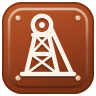
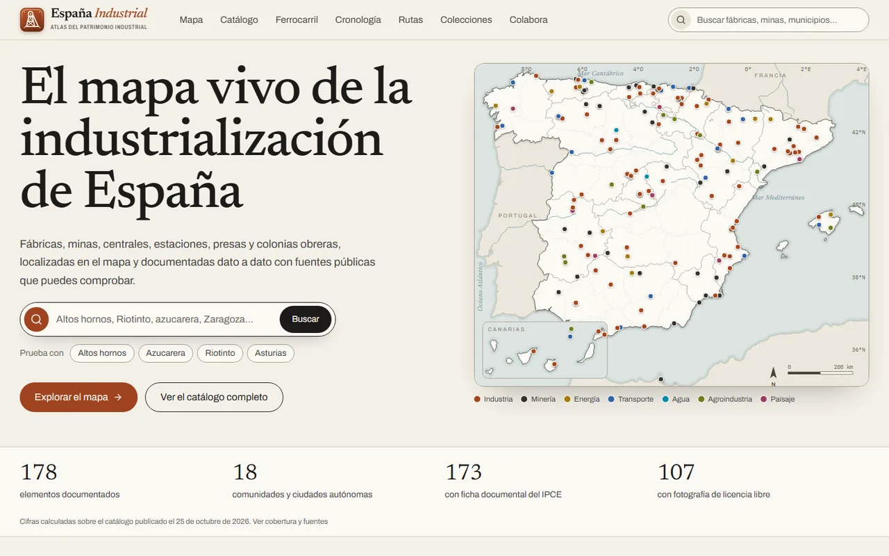
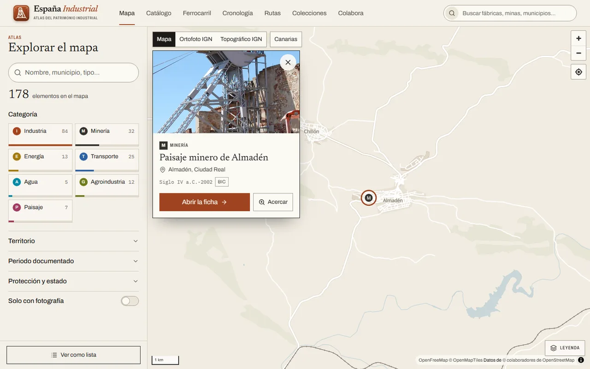
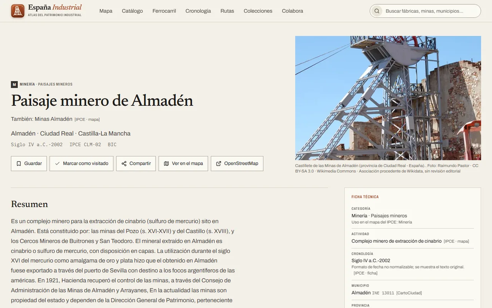
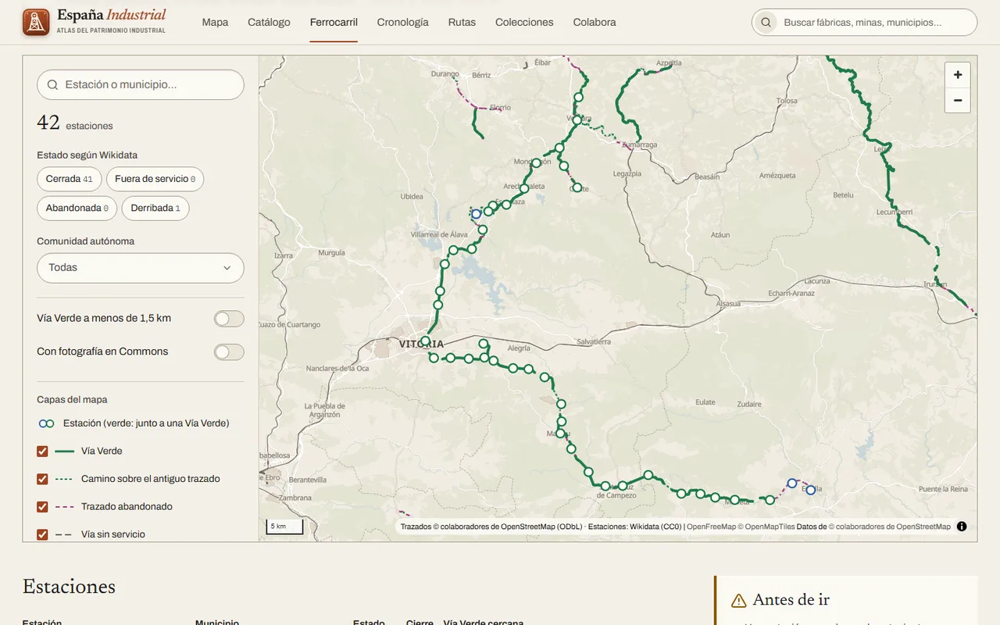
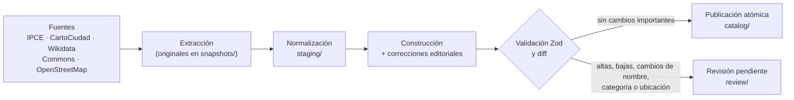

<p align="center">
  
</p>

<h1 align="center">España Industrial</h1>

<p align="center">
  <em>El mapa vivo de la industrialización de España</em>
</p>

<p align="center">
  Atlas digital del patrimonio industrial español: fábricas, minas, centrales, estaciones, presas y colonias obreras,<br>
  localizadas en un mapa interactivo y documentadas dato a dato con fuentes públicas que se pueden comprobar.
</p>

<p align="center">
  <a href="LICENSE"></a>
  <a href="LICENSE-DATA.md"></a>
  <a href="LICENSE-DATA.md#conjunto-de-datos-ferroviario-odbl"></a>
  
  
  
</p>

<p align="center">
  <a href="https://ivangarmar22.github.io/EspanaIndustrial/"><strong>🌐 Ver la web</strong></a> ·
  <a href="#qué-ofrece">Qué ofrece</a> ·
  <a href="#puesta-en-marcha">Puesta en marcha</a> ·
  <a href="#cómo-funcionan-los-datos">Datos</a> ·
  <a href="#documentación">Documentación</a> ·
  <a href="#colaborar">Colaborar</a> ·
  <a href="#licencias">Licencias</a>
</p>

<p align="center">
  
</p>

> [!NOTE]
> Proyecto independiente y sin ánimo de lucro. No está afiliado al Ministerio de Cultura ni a ninguna administración. Origen de los datos principales: Ministerio de Cultura (IPCE, Plan Nacional de Patrimonio Industrial), reutilizados conforme a su licencia general.

## Qué ofrece

|                            |                                                                                                                                             |
| -------------------------- | ------------------------------------------------------------------------------------------------------------------------------------------- |
| 🗺️ **Mapa interactivo**    | Cartografía de OpenFreeMap con ortofotos y mapas topográficos del IGN, filtros por categoría, territorio, periodo, protección y estado.     |
| 📚 **Catálogo y fichas**   | Cada dato indica de qué fuente procede, cuándo se consultó y con qué licencia. Lo que no está documentado se deja en blanco, sin inventar.  |
| 🚂 **Ferrocarril**         | Estaciones cerradas, trazados abandonados y Vías Verdes que hoy se pueden recorrer a pie o en bicicleta, con una página por cada línea.     |
| 🧭 **Rutas y colecciones** | Itinerarios por territorios y temas (minería, hierro, azúcar, agua…) y colecciones que se recalculan solas a partir del catálogo.           |
| 🕰️ **Cronología**          | La industrialización de España por décadas, con las fechas tal y como las recogen las fuentes.                                              |
| 🤝 **Colabora**            | Formulario para proponer lugares, correcciones y fotografías, que llega por correo y se revisa antes de publicarse. Donaciones voluntarias. |

### En cifras

| Elementos documentados | Con ficha del IPCE | Enlazados con Wikidata | Con fotografía libre | Estaciones cerradas | Vías Verdes cartografiadas | Rutas · colecciones |
| :--------------------: | :----------------: | :--------------------: | :------------------: | :-----------------: | :------------------------: | :-----------------: |
|        **178**         |      **173**       |        **156**         |       **107**        |      **1.267**      |        **2.216 km**        |     **25 · 25**     |

Las cifras actualizadas se calculan a partir del catálogo publicado y se muestran en la página `/fuentes` de la propia web.

### Capturas

<table>
  <tr>
    <td width="50%"></td>
    <td width="50%"></td>
  </tr>
  <tr>
    <td align="center"><sub>Mapa interactivo con filtros</sub></td>
    <td align="center"><sub>Ficha con la procedencia de cada dato</sub></td>
  </tr>
  <tr>
    <td colspan="2"></td>
  </tr>
  <tr>
    <td colspan="2" align="center"><sub>Sección de ferrocarril: estaciones cerradas del Vasco-Navarro y su Vía Verde</sub></td>
  </tr>
</table>

<sub>Las capturas incluyen una fotografía de Raimundo Pastor (CC BY-SA 3.0, Wikimedia Commons).</sub>

## Puesta en marcha

**Requisitos:** Node.js ≥ 22.12 (probado con 24, ver `.nvmrc`), npm ≥ 10 y conexión a internet para las tipografías del build y las teselas del mapa.

```bash
npm ci
cp .env.example .env.local          # y rellénalo (ver abajo)
npm run data:media                  # descarga las fotografías con licencia (≈ 70 MB, no se versionan)
npm run data:update -- --no-fetch   # enlaza las fotos descargadas en el catálogo
npm run dev                         # http://127.0.0.1:3000
```

El catálogo publicado (`data/catalog/catalog.json`), los datos intermedios (`data/staging/`) y el conjunto ferroviario (`data/rail/`) están versionados, así que la web funciona sin volver a descargar las fuentes.

<details>
<summary><strong>Variables de entorno</strong> (<code>.env.local</code>)</summary>

| Variable                                                                             | Uso                                                                                                |
| ------------------------------------------------------------------------------------ | -------------------------------------------------------------------------------------------------- |
| `NEXT_PUBLIC_SITE_URL`                                                               | URL base para enlaces canónicos, sitemap y Open Graph.                                             |
| `NEXT_PUBLIC_WEB3FORMS_KEY`                                                          | Clave de [Web3Forms](https://web3forms.com/) para que las propuestas lleguen por correo.           |
| `NEXT_PUBLIC_BASE_PATH`                                                              | Subruta de publicación (`/EspanaIndustrial` en GitHub Pages; vacía en local).                      |
| `NEXT_PUBLIC_DONATE_PAYPAL` · `NEXT_PUBLIC_DONATE_KOFI` · `NEXT_PUBLIC_DONATE_BIZUM` | Canales de donación de «Colabora»; solo se muestran los configurados.                              |
| `DATA_CONTACT`                                                                       | Contacto incluido en el User-Agent de las peticiones del pipeline (por defecto, este repositorio). |

Los secretos nunca se versionan: `.env*` está en `.gitignore` salvo `.env.example`.

</details>

<details>
<summary><strong>Todos los comandos</strong></summary>

| Comando                                 | Qué hace                                                                                                                           |
| --------------------------------------- | ---------------------------------------------------------------------------------------------------------------------------------- |
| `npm run dev` / `build` / `start`       | Desarrollo, exportación estática a `out/` y vista previa de esa exportación (escuchan en 127.0.0.1).                               |
| `npm run check`                         | Tipos, lint, pruebas y validación de datos.                                                                                        |
| `npm run typecheck` · `lint` · `format` | Calidad de código.                                                                                                                 |
| `npm test`                              | Pruebas unitarias y de integración (Vitest).                                                                                       |
| `npm run test:e2e`                      | Pruebas end-to-end y de accesibilidad (Playwright + axe). Construye y arranca la app en el puerto 3100.                            |
| `npm run data:update`                   | Pipeline completo. Opciones: `--approve`, `--no-fetch`, `--fetch-only`, `--offline`, `--refresh`, `--source <id>`.                 |
| `npm run data:fetch`                    | Solo descarga y actualiza el staging.                                                                                              |
| `npm run data:import -- <id>`           | Descarga una sola fuente y reconstruye (`ministerio-cultura`, `cartociudad`, `wikidata`, `wikimedia-commons`).                     |
| `npm run data:validate`                 | Comprueba la integridad del catálogo y de la capa editorial y exporta el JSON Schema.                                              |
| `npm run data:diff`                     | Muestra la actualización pendiente de aprobación frente a lo publicado.                                                            |
| `npm run data:duplicates`               | Lista los posibles duplicados sin decidir.                                                                                         |
| `npm run data:media`                    | Descarga las miniaturas de Commons (nunca se enlazan en caliente).                                                                 |
| `npm run data:rail`                     | Conjunto ferroviario (Wikidata y OpenStreetMap). `--keep-osm` reutiliza la última descarga de Overpass; `--offline` no usa la red. |
| `npm run data:links`                    | Comprueba los enlaces externos con peticiones espaciadas.                                                                          |
| `npm run maintenance:outline`           | Regenera la cartografía del mapa de la portada a partir de Natural Earth.                                                          |

</details>

## Cómo funcionan los datos



- **Nada se inventa:** los datos desconocidos se dejan en blanco y cada valor conserva su fuente, fecha y licencia.
- **El catálogo nunca se vacía:** si una fuente no responde, se conserva su último staging correcto.
- **Los cambios importantes se revisan:** altas, bajas, cambios de nombre, categoría, protección o ubicación (> 100 m) esperan a `npm run data:diff` y `--approve`.
- **Las correcciones manuales mandan:** viven en `data/overrides/` con su fuente y la sincronización nunca las sobrescribe.
- **Sin panel de administración ni servidor:** la web es estática (GitHub Pages); las propuestas del público llegan por correo a través de Web3Forms y se incorporan a mano.

<details>
<summary><strong>Estructura del repositorio</strong></summary>

```
src/app/           Rutas (App Router): (site) web editorial, (map) mapa a pantalla completa, api
src/components/    Componentes de presentación compartidos
src/features/      Funcionalidades: map, rail, record, catalog, routes, home, favorites, contributions
src/domain/        Esquemas Zod, tipos, vocabularios, territorios, fechas, filtros (sin E/S)
src/data-access/   Lectura del catálogo, del ferrocarril y del contenido editorial
src/pipeline/      Conectores, construcción, diff, duplicados, publicación y conjunto ferroviario
scripts/           CLI de datos y mantenimiento
data/              Catálogo publicado, staging, capa editorial, ferrocarril e informes
docs/              Investigación de fuentes, arquitectura, datos y despliegue
tests/             unit, integration, e2e y fixtures con procedencia documentada
```

</details>

## Documentación

| Tema                     | Documentos                                                                                                                                                                                                              |
| ------------------------ | ----------------------------------------------------------------------------------------------------------------------------------------------------------------------------------------------------------------------- |
| Investigación de fuentes | [Catálogo de fuentes](docs/research/source-catalog.md) · [Derechos de reutilización](docs/research/data-rights.md) · [Plan de adquisición](docs/research/data-acquisition-plan.md)                                      |
| Arquitectura y datos     | [Arquitectura](docs/architecture/overview.md) · [Organización de los datos](docs/data/data-layout.md) · [Política de calidad](docs/data/quality-policy.md) · [Revisión de octubre de 2026](docs/data/review-2026-10.md) |
| Fuente principal         | [Ministerio de Cultura (IPCE)](docs/data/sources/ministerio-cultura.md)                                                                                                                                                 |
| Despliegue               | [Publicación en GitHub Pages, ejecución local y actualizaciones](docs/deployment/local.md)                                                                                                                              |

## Limitaciones conocidas

- El catálogo cubre el listado del Plan Nacional de Patrimonio Industrial (177 bienes en 178 registros), no todo el patrimonio industrial de España. Los inventarios autonómicos están investigados pero no integrados.
- La extracción de las fichas PDF es automática: los textos se marcan como pendientes de revisión y se descartan los campos que la maquetación corta.
- Las correcciones editoriales (40 registros) están documentadas con su fuente; ningún registro está marcado aún como verificado en su conjunto.
- Las fotografías de las fichas del IPCE no se reutilizan (tienen créditos de terceros): solo se muestran fotos de Commons con licencia libre.
- Las rutas son propuestas del proyecto: las distancias se miden en línea recta y no se calculan duraciones.
- El estado de las líneas de ferrocarril es el que indica Wikidata y puede no reflejar cierres parciales.

## Colaborar

- **Propón un lugar, una corrección o una fotografía** desde la página «Colabora» de la web.
- **Sube fotografías a Wikimedia Commons** y enlázalas en Wikidata: las fichas las muestran con su autoría.
- **Corrige estaciones o trazados** directamente en Wikidata u OpenStreetMap; la siguiente actualización los recoge.
- **Informa de errores o propón mejoras** en las [incidencias de GitHub](https://github.com/ivangarmar22/EspanaIndustrial/issues). Antes de enviar cambios, ejecuta `npm run check`.

## Licencias

| Componente                | Licencia                                                                                                                                                 |
| ------------------------- | -------------------------------------------------------------------------------------------------------------------------------------------------------- |
| Código                    | [MIT](LICENSE)                                                                                                                                           |
| Catálogo y textos propios | [CC BY 4.0](LICENSE-DATA.md), conservando las condiciones de cada fuente («Origen de los datos: Ministerio de Cultura», CartoCiudad © IGN, Wikidata CC0) |
| Conjunto ferroviario      | [ODbL 1.0](LICENSE-DATA.md#conjunto-de-datos-ferroviario-odbl) (© colaboradores de OpenStreetMap; estaciones de Wikidata, CC0)                           |
| Imágenes                  | Licencia individual indicada en cada una; no se relicencian                                                                                              |
| Cartografía               | OpenFreeMap © OpenMapTiles, datos © colaboradores de OpenStreetMap (ODbL); capas del IGN (CC BY 4.0); Natural Earth (dominio público)                    |
| Tipografías               | Newsreader, Archivo e IBM Plex Mono (SIL Open Font License)                                                                                              |
